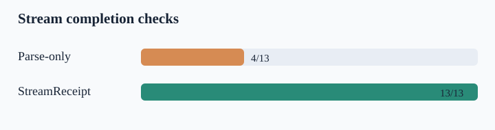

# StreamReceipt



StreamReceipt is an offline CLI that checks whether a captured LLM stream contains enough evidence to dispatch client tool calls. It accepts raw OpenAI Chat Completions or Anthropic Messages server-sent events (SSE), assembles tool argument fragments, verifies the provider's completion markers and stop reason, and records whether usage was observed. It never calls a model or executes a tool.

An AI platform engineer can put this check between a recorded gateway stream and a regression test. A receipt says `dispatch_allowed`, `blocked`, or `inconclusive`. It reports counts, a transcript digest, and stable finding codes without echoing tool names, IDs, prompts, or argument bytes. It is not an authorization decision or a JSON Schema validator.

## Why this exists

Official [OpenAI streaming events](https://developers.openai.com/api/reference/resources/chat/subresources/completions/streaming-events) document that final usage may be absent after interruption. [Claude's streaming protocol](https://platform.claude.com/docs/en/build-with-claude/streaming) has a different sequence of content-block and message terminal events, with cumulative usage. Recent [OpenAI SDK early-EOF](https://github.com/openai/openai-python/issues/4063), [Vercel AI SDK skipped-tool](https://github.com/vercel/ai/issues/22912), and [LiteLLM usage](https://github.com/BerriAI/litellm/issues/36114) issue reports show concrete places where parseable fragments or completed SDK values can conceal missing terminal or accounting evidence. These reports motivate local checks; StreamReceipt does not claim that every version or deployment has those defects.

The existing `llm-structured-output-fuzzer` in this portfolio tests completed JSON strings. `fallbacklens` tests route contracts and sampled logical traces. StreamReceipt checks the earlier streaming boundary across two provider protocols. It independently implements a small offline audit rather than copying SDK source or building another gateway.

## Run it

Python 3.10+ is required. The runtime has no third-party dependencies.

```powershell
py -m pip install -e .
streamreceipt audit examples/openai-safe.sse --provider openai-chat --require-usage
streamreceipt audit examples/anthropic-safe.sse --provider anthropic-messages --require-usage --json artifacts/anthropic-report.json
streamreceipt benchmark --out artifacts
```

An audit exits 0 for `dispatch_allowed`, 2 for `inconclusive`, and 3 for `blocked`. A malformed command or unreadable input exits through the CLI parser. The JSON report contains a SHA-256 transcript digest for local linkage. A digest does not anonymize a transcript, and captured raw streams should be handled as sensitive data.

The optional `--require-usage` asks for provider-reported token usage. Without it, a protocol-complete stream with missing usage can still allow dispatch, while `usage_observed` remains false. This separation matters because usage evidence is not itself proof of tool safety and provider-reported tokens are not a bill reconciliation.

## What it checks

| Protocol | Dispatch evidence | Usage evidence |
|---|---|---|
| OpenAI Chat Completions | Choice 0 has one `tool_calls` finish reason, `[DONE]`, stable response and tool IDs, names, and JSON-object arguments. | One valid `usage` object, when requested. |
| Anthropic Messages | Message and content-block lifecycle closes, one `tool_use` stop reason and `message_stop`, unique client tool IDs, and JSON-object inputs. | Input count from `message_start` and output count from `message_delta`, when requested. |

Unknown or absent terminal evidence is inconclusive. Malformed arguments, conflicting IDs, unsafe stop reasons, provider errors, and invalid block order are blocked. Reports are content-minimized; they do not display tool inputs. Inputs are bounded to 1 MiB, 10,000 events, 64 tool slots and 64 KiB per argument.

## Reproduce the evaluation

```powershell
py -m pip install -e .
py -m unittest discover -s tests -v
streamreceipt benchmark --out artifacts
```

The authored `streamreceipt-authored-v1` corpus has 13 synthetic cases: two safe controls and mutations for missing terminal markers, unsafe stops, malformed JSON, conflicting metadata, open blocks, and missing usage. In the verified local run on 2026-10-22, StreamReceipt matched 13/13 expected verdicts; a declared parse-only assembler matched 4/13. The baseline only checks whether concatenated tool fragments form a JSON object. These are implementation-aligned fixtures, not a production false-positive or provider-quality benchmark. See [experiment log](docs/experiments/2026-10-22-authored-corpus.md) and [raw evidence](artifacts/benchmark.json).

## Architecture and limits

The SSE parser bounds and separates events. A provider adapter assembles tool fragments and checks lifecycle invariants. The receipt layer turns finding codes into a verdict and emits deterministic JSON; the benchmark builds the SVG above. There is no live network path, proxy, model dependency, or hidden dispatch function.

This first slice supports only one OpenAI Chat Completion choice and Anthropic client `tool_use` blocks. It does not validate a tool's application schema, authorization, semantic intent, server tools, OpenAI Responses events, multimodal content, request retries, actual provider bills, or signed provenance. A `dispatch_allowed` receipt should be combined with application policy and schema validation before any real effect. Unknown provider variants need explicit adapters and tests.

## Project records

- [Approved design spec](docs/superpowers/specs/2026-10-22-streamreceipt.md)
- [Reference and decision record](docs/decisions/2026-10-22-offline-stream-receipts.md)
- [Working notes](docs/notes/2026-10-22-build.md)
- [Synthetic dataset card](docs/datasets/streamreceipt-authored-v1.md)
- [Model non-use card](docs/models/no-model-v1.md)

The next useful improvement is an independently captured, sanitized fixture set from OpenAI and Anthropic SDK mock transports and an OpenAI Responses adapter. This would test the boundary between the authored protocol cases and real SDK output without paid calls.

## License

MIT. See [LICENSE](LICENSE). Provider documentation and SDKs are cited as references; no upstream code, fixtures, or model outputs were copied.
